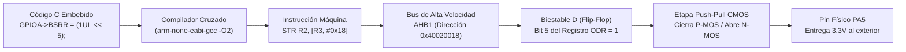
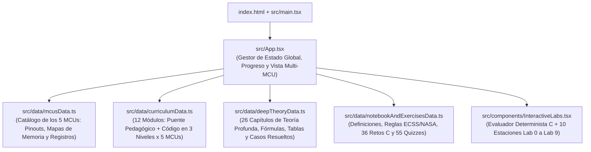

# Programación C en Sistemas Embebidos, Arquitectura de Microcontroladores y Normativa Aeroespacial (ECSS / NASA)

> 🚀 **Plataforma Interactiva en Vivo (GitHub Pages):**  
> ### 👉 **[https://pacovalgor.github.io/ProgramacionC/](https://pacovalgor.github.io/ProgramacionC/)**
> *(Haz clic en el enlace superior para abrir directamente el curso interactivo, los 10 laboratorios de hardware y los editores C en vivo desde tu navegador).*

Plataforma interactiva de aprendizaje, simulador de hardware a nivel de registro y libro de texto de ingeniería en español diseñado para dominar la **Programación en C para Sistemas Embebidos** desde los cimientos de la memoria (`Módulo 0`) hasta el diseño de firmware crítico aeroespacial y de defensa (`Módulo 21`).

---

## Tabla de Contenidos

1. [Propósito Pedagógico: El Puente entre el Código C y el Silicio](#1-propósito-pedagógico-el-puente-entre-el-código-c-y-el-silicio)
2. [Cómo viaja una línea de C hasta un Transistor Físico](#2-cómo-viaja-una-línea-de-c-hasta-un-transistor-físico)
3. [Los 5 Microcontroladores Reales del Catálogo](#3-los-5-microcontroladores-reales-del-catálogo)
4. [Los 3 Niveles de Abstracción en C Embebido](#4-los-3-niveles-de-abstracción-en-c-embebido)
5. [Guía Educativa Rápida (Cheat-Sheet de Ingeniería Embebida)](#5-guía-educativa-rápida-cheat-sheet-de-ingeniería-embebida)
   - [5.1 Las 5 Operaciones Bit a Bit Imprescindibles](#51-las-5-operaciones-bit-a-bit-imprescindibles)
   - [5.2 Mapa de Memoria y Secciones del Linker](#52-mapa-de-memoria-y-secciones-del-linker)
   - [5.3 El Calificador `volatile` y la Atomicidad Hardware](#53-el-calificador-volatile-y-la-atomicidad-hardware)
6. [Plan de Estudios Completo: 12 Módulos y 26 Capítulos de Teoría Profunda](#6-plan-de-estudios-completo-12-módulos-y-26-capítulos-de-teoría-profunda)
7. [Las 10 Estaciones del Laboratorio Interactivo (`Lab 0` a `Lab 9`)](#7-las-10-estaciones-del-laboratorio-interactivo-lab-0-a-lab-9)
8. [Compendio de Normativa Aeroespacial y Defensa (Europa ECSS vs EE. UU. NASA / DO-178C)](#8-compendio-de-normativa-aeroespacial-y-defensa-europa-ecss-vs-ee-uu-nasa--do-178c)
   - [8.1 Categorías de Criticidad (ECSS Cat A–D vs DO-178C DAL A–E)](#81-categorías-de-criticidad-ecss-cat-ad-vs-do-178c-dal-ae)
   - [8.2 Matriz de Reglas: PROHIBIDO (`SHALL NOT`), OBLIGATORIO (`SHALL`) y DESACONSEJADO (`SHOULD NOT`)](#82-matriz-de-reglas-prohibido-shall-not-obligatorio-shall-y-desaconsejado-should-not)
   - [8.3 Los 14 Checks Oficiales de Verificación de Código (`ECSS-E-ST-40C Annex U.2`)](#83-los-14-checks-oficiales-de-verificación-de-código-ecss-e-st-40c-annex-u2)
   - [8.4 Fórmulas Oficiales de Márgenes (`ECSS Annex M`), Cobertura `100% MC/DC` y `Rad-Hard`](#84-fórmulas-oficiales-de-márgenes-ecss-annex-m-cobertura-100-mcdc-y-rad-hard)
9. [Arquitectura del Software y Guía de Mantenimiento](#9-arquitectura-del-software-y-guía-de-mantenimiento)
10. [Instalación y Puesta en Marcha](#10-instalación-y-puesta-en-marcha)

---

## 1. Propósito Pedagógico: El Puente entre el Código C y el Silicio

Quienes aprenden sistemas embebidos suelen encontrarse con dos extremos desconectados:

- **El extremo superficial:** Tutoriales básicos que enseñan a llamar a funciones opacas como `digitalWrite(13, HIGH)` o `delay(1000)` sin explicar qué ocurre en los registros, en el reloj del bus ni en la etapa de salida de los transistores.
- **El extremo abrumador:** Hojas de datos (*Datasheets* y *Reference Manuals*) de más de 1.500 páginas en inglés repletas de tablas de registros, offsets hexadecimales (`0x40020018`) y diagramas de bloques sin una guía progresiva de cómo traducirlos a código C limpio, portable y seguro.

Este proyecto construye el **puente exacto entre ambos mundos** con una metodología pensada para estudiar y consolidar conceptos escribiendo en un **cuaderno físico de papel** mientras se experimenta en tiempo real en el navegador:

1. **Cada concepto teórico se conecta con su realidad física en silicio:** No solo se define qué es un puntero, un campo de bits o el calificador `volatile`, sino qué puertas lógicas, líneas de bus de direcciones, biestables D (*Flip-Flops*) o transistores MOSFET P/N se conmutan al ejecutarlo.
2. **Aprendizaje comparativo en 5 arquitecturas reales a la vez:** Evita memorizar recetas para un único chip mostrando cómo resuelven exactamente el mismo problema un AVR de 8 bits, dos ARM Cortex-M4F, un Dual Cortex-M0+ y un RISC-V de 32 bits.
3. **Rigor de ingeniería industrial y aeroespacial:** Integra desde el primer módulo las buenas prácticas de **MISRA-C:2012**, **NASA JPL (*Power of Ten*)**, **RTCA DO-178C** y los estándares oficiales europeos **ESA ECSS-E-ST-40C Rev.1** y **ECSS-Q-ST-80C Rev.2**.

---

## 2. Cómo viaja una línea de C hasta un Transistor Físico

Cuando escribes una sentencia en C embebido, no estás modificando una variable abstracta: estás activando un decodificador de direcciones en el bus interno del chip para cargar carga eléctrica en un biestable conectado a una etapa de potencia CMOS:



---

## 3. Los 5 Microcontroladores Reales del Catálogo

En cualquier momento del curso o de los laboratorios puedes alternar entre **5 microcontroladores representativos de la industria** (o visualizar su código en paralelo):

| Microcontrolador | Fabricante | Arquitectura / ISA | Ancho | Reloj | Memoria (Flash / SRAM) | Tensión | Clock Gating Requerido | Mecanismo Atómico de GPIO en Hardware | Rol Pedagógico en el Curso |
| :--- | :--- | :--- | :---: | :---: | :---: | :---: | :---: | :--- | :--- |
| **ATmega328P** | Microchip (Atmel) | AVR RISC (Harvard puro) | `8 bits` | 16 MHz | 32 KB / 2 KB | `5.0 V` | No | Instrucciones `SBI` / `CBI` en los primeros 32 registros I/O | Ideal para iniciarse: 1 registro de 8 bits (`DDRB`, `PORTB`, `PINB`) equivale a 8 pines físicos con relación 1:1 directa. |
| **STM32F401RE** | STMicroelectronics | ARM Cortex-M4F (con FPU) | `32 bits` | 84 MHz | 512 KB / 96 KB | `3.3 V` | **Sí** (`RCC->AHB1ENR`) | Registro `GPIOx->BSRR` (Bits `0..15` Set, Bits `16..31` Reset) | El estándar de la industria automotriz e industrial: enseña buses `AHB`/`APB`, Clock Gating y campos de configuración de 2 bits (`MODER`). |
| **ESP32-C3** | Espressif | RISC-V 32-bit (`RV32IMC`) | `32 bits` | 160 MHz | 4 MB / 400 KB | `3.3 V` | Sí (activo por defecto en GPIO) | Registros `GPIO.out_w1ts` (*Write-1-to-Set*) y `GPIO.out_w1tc` (*Write-1-to-Clear*) | Introduce la arquitectura abierta **RISC-V** y la Matriz de Pines flexible (*GPIO Matrix* + `IO_MUX`). |
| **nRF52840** | Nordic Semiconductor | ARM Cortex-M4F | `32 bits` | 64 MHz | 1 MB / 256 KB | `1.7–3.3 V` | No (Gestión automática UL-Power) | Registros separados `NRF_P0->OUTSET` y `NRF_P0->OUTCLR` | Diseño **Ultra-Low-Power**: enseña el sistema **PPI** (*Programmable Peripheral Interconnect* sin despertar a la CPU) y **EasyDMA**. |
| **RP2040** | Raspberry Pi | Dual-Core ARM Cortex-M0+ | `32 bits` | 133 MHz | 2 MB QSPI / 264 KB | `3.3 V` | Sí (`RESETS->RESET`) | Bloque **SIO** de 1 ciclo (`gpio_set`, `gpio_clr`, `gpio_togl`) + Aliases HW (`+0x2000` / `+0x3000`) | Enseña sistemas **Multicore**, buses dedicados de ciclo único (`IOPORT`) y máquinas de estados programables **PIO**. |

---

## 4. Los 3 Niveles de Abstracción en C Embebido

Todo ejemplo de código del curso se presenta simultáneamente en los **3 niveles de abstracción** que encontrarás en tu vida profesional:

### Nivel 1: Puntero Crudo a Dirección Física (`rawPointer`)
Demuestra que los nombres de registros no son palabras mágicas del compilador, sino simples direcciones numéricas del mapa de memoria desreferenciadas con `volatile`:

```c
// Encender PA5 en STM32F401 escribiendo directamente en las direcciones del Datasheet:
#define RCC_AHB1ENR_REG  (*(volatile uint32_t *)0x40023830UL)
#define GPIOA_MODER_REG  (*(volatile uint32_t *)0x40020000UL)
#define GPIOA_BSRR_REG   (*(volatile uint32_t *)0x40020018UL)

void led_init_and_on(void) {
    RCC_AHB1ENR_REG |= (1UL << 0);                          // 1. Activar reloj AHB1 para GPIOA
    GPIOA_MODER_REG  = (GPIOA_MODER_REG & ~(3UL << 10))
                     | (1UL << 10);                         // 2. PA5 [11:10] = 01 (Salida)
    GPIOA_BSRR_REG   = (1UL << 5);                          // 3. Escritura atómica: PA5 = 3.3V
}
```

### Nivel 2: Estructuras Oficiales del Fabricante (`cmsisStruct`)
Utiliza un `struct` cuyos miembros coinciden byte a byte con los offsets de los registros del periférico, apuntando a la dirección base:

```c
// Estándar CMSIS (stm32f401xe.h):
#include "stm32f4xx.h"

void led_init_and_on(void) {
    RCC->AHB1ENR |= RCC_AHB1ENR_GPIOAEN;
    GPIOA->MODER  = (GPIOA->MODER & ~(3UL << (5U * 2U))) | (1UL << (5U * 2U));
    GPIOA->BSRR   = GPIO_BSRR_BS5; // Atómico en 1 ciclo de instrucción STR
}
```

### Nivel 3: Driver Profesional de Producción (`proDriver`)
Encapsula el hardware detrás de estructuras de configuración tipadas, validaciones defensivas contra punteros `NULL` y códigos de retorno explícitos conforme a **MISRA-C** y **ECSS**:

```c
typedef struct {
    GPIO_TypeDef *port;
    uint8_t       pin;
} gpio_handle_t;

bool gpio_write_atomic(const gpio_handle_t *h, bool state) {
    if ((h == NULL) || (h->port == NULL) || (h->pin > 15U)) {
        return false; // Protección defensiva (ECSS Annex U.2 #9 y #10)
    }
    h->port->BSRR = state ? (1UL << h->pin) : (1UL << (h->pin + 16U));
    return true;
}
```

---

## 5. Guía Educativa Rápida (Cheat-Sheet de Ingeniería Embebida)

### 5.1 Las 5 Operaciones Bit a Bit Imprescindibles

En sistemas embebidos un único registro controla múltiples funciones independientes. **Nunca debes sobrescribir el registro entero con `=`** si otros bits gobiernan periféricos vecinos (salvo en registros de disparo atómico `W1S`/`W1C` como `BSRR` o `OUTSET`):

| Operación | Sintaxis Canónica en C | Qué hace en el Hardware | Por qué funciona (Álgebra de Boole) |
| :--- | :--- | :--- | :--- |
| **1. Encender un bit (SET)** | `REG \|= (1UL << n);` | Fuerza el bit `n` a `1` dejando los otros 31 bits intactos. | `X \| 1 = 1` y `X \| 0 = X` |
| **2. Apagar un bit (CLEAR)** | `REG &= ~(1UL << n);` | Fuerza el bit `n` a `0` dejando los otros 31 bits intactos. | `~(1UL << n)` crea un `0` en `n` y `1` en el resto (`X & 0 = 0`, `X & 1 = X`). |
| **3. Invertir un bit (TOGGLE)** | `REG ^= (1UL << n);` | Si el bit `n` valía `0` pasa a `1`; si valía `1` pasa a `0`. | `X ^ 1 = ~X` y `X ^ 0 = X` |
| **4. Leer el estado de un bit** | `bit = (REG >> n) & 1UL;` | Devuelve `1` o `0` limpio en el bit menos significativo. | Desplaza el bit `n` a la posición `0` y enmascara el resto con `& 1UL`. |
| **5. Escribir un campo multicelda** | `REG = (REG & ~(mask << pos)) \| (val << pos);` | Limpia primero el hueco del campo a `0` y luego inserta el nuevo valor. | Evita que bits antiguos a `1` se mezclen con el nuevo valor si se hiciera solo `\|=`. |

---

### 5.2 Mapa de Memoria y Secciones del Linker

Un microcontrolador divide su espacio de direcciones en regiones físicas con propiedades eléctricas muy distintas:

| Sección del Linker | Memoria Física | ¿Volátil? | Qué almacena el Compilador C | Ejemplo en Código C |
| :--- | :---: | :---: | :--- | :--- |
| **`.text`** | **Flash** (No volátil) | No | Instrucciones máquina compiladas de todas las funciones y tabla de vectores de interrupción (`ISR`). | `void control_loop(void) { ... }` |
| **`.rodata`** | **Flash** (No volátil) | No | Constantes globales marcadas con `const`. **Ahorra SRAM valiosa.** | `static const uint16_t LUT[4] = {10, 20, 30, 40};` |
| **`.data`** | **Flash $\rightarrow$ SRAM** | Sí | Variables globales o `static` inicializadas con un valor distinto de cero (el código `Reset_Handler` las copia de Flash a SRAM al arrancar). | `static uint32_t s_baudrate = 115200UL;` |
| **`.bss`** | **SRAM** | Sí | Variables globales o `static` sin inicializar o inicializadas a `0` (el `Reset_Handler` limpia esta zona a `0x00` al arrancar). | `static uint8_t s_rx_buffer[256];` |
| **`Stack` (Pila)** | **SRAM** | Sí | Variables locales de funciones, parámetros y copia de registros al saltar a una interrupción (`ISR`). Crece hacia direcciones bajas. | `uint32_t temp = 0U;` (dentro de una función) |
| **`MMIO` (Periféricos)** | **Registros de Silicio** | Sí | Biestables conectados físicamente a periféricos (`GPIO`, `UART`, `ADC`, `TIM`, `DMA`). | `*(volatile uint32_t *)0x40020014UL` |

---

### 5.3 El Calificador `volatile` y la Atomicidad Hardware

- **Cuándo es obligatorio usar `volatile`:**
  1. En todo puntero a un **registro de hardware (`MMIO`)**: sin `volatile`, el optimizador (`-O2`) cachea el valor en un registro interno de la CPU (`R0..R12`) y elimina lecturas o escrituras reales al bus físico.
  2. En toda **variable global compartida entre una interrupción (`ISR`) y el bucle principal (`main`)**: sin `volatile`, un bucle `while (flag == 0)` se convierte en un bloqueo infinito en ensamblador porque el compilador asume que `flag` nunca cambia por sí sola.
- **Qué NO resuelve `volatile`:** `volatile` **no hace que una operación sea atómica**. Una sentencia `GPIOA->ODR |= (1UL << 5);` compila en tres instrucciones máquina separadas (`LDR` $\rightarrow$ `ORR` $\rightarrow$ `STR`). Si una interrupción salta entre el `LDR` y el `STR` y modifica otro pin del mismo puerto, al regresar a `main()` la instrucción `STR` sobrescribirá el cambio de la interrupción (**Condición de Carrera Read-Modify-Write**). Por eso en código de producción se usan registros de escritura atómica directa (`GPIOA->BSRR`, `NRF_P0->OUTSET`, `GPIO.out_w1ts`, `sio_hw->gpio_set`).

---

## 6. Plan de Estudios Completo: 22 Módulos y 52 Capítulos de Teoría Profunda

| Módulo | Título del Módulo | Capítulos de Teoría Profunda Incluidos | Laboratorio Asociado |
| :---: | :--- | :--- | :---: |
| **Módulo 0** | **El Alfabeto del Silicio: Bits, Bytes, Tipos (`<stdint.h>`) y Memoria** | • **Cap 0.1:** Representación en Memoria, Complemento a Dos, Endianness y `sizeof()`<br>• **Cap 0.2:** El Preprocesador de C, Macros Parametrizadas Seguras y Header Guards | `Lab 0` |
| **Módulo 1** | **Punteros Físicos, Memoria MMIO y Calificadores Básicos** | • **Cap 1.1:** Punteros a Fondo, Operador `&` y `*`, Paso por Valor vs Referencia<br>• **Cap 1.2:** Anatomía del Puntero MMIO en 3 Capas, Calificador `volatile`, `const*` y `(void)var` | `Lab 0` |
| **Módulo 2** | **Estructuras (`struct`), Padding, Alineación y Uniones (`union`)** | • **Cap 2.1:** Estructuras, Padding de Alineación a 32 bits, Uniones y Operador Flecha (`->`)<br>• **Cap 2.2:** Construcción de Headers de Hardware desde Cero (Cómo nace CMSIS) | `Lab 0` |
| **Módulo 3** | **Manipulación de Bits en Hardware: Gimnasio de Bits y Macros MISRA-C** | • **Cap 3.1:** Anatomía de Literales (`U`/`UL`) y las 6 Operaciones Sagradas de Bits<br>• **Cap 3.2:** Álgebra Booleana Bit a Bit vs Operadores Lógicos<br>• **Cap 3.3:** Desplazamiento Lógico (`LSR`) vs Aritmético (`ASR`) con `>>`<br>• **Cap 3.4:** Campos Multi-Bit (*Clear & Insert*) y Macros Blindadas (MISRA-C) | `Lab 2` |
| **Módulo 4** | **Arquitectura de Memoria, Buses (`AHB`/`APB`) y el Secreto de los Relojes (`RCC`)** | • **Cap 4.1:** Proceso de Compilación, Linker Script (`.ld`) y `Reset_Handler`<br>• **Cap 4.2:** Árbol de Relojes, `PLL` y Puertas de Reloj (*Clock Gating* con `RCC`) | `Lab 4` |
| **Módulo 5** | **GPIO a Nivel de Silicio: MOSFETs, `Push-Pull`, `Open-Drain` y Escritura Atómica** | • **Cap 5.1:** Ingeniería Eléctrica del Pin, Ley de Ohm y Niveles Lógicos CMOS<br>• **Cap 5.2:** Rebote Mecánico (*Switch Bounce*) y Filtro Digital Antirrebote en C<br>• **Cap 5.3:** Tipos Enumerados (`enum`) en Firmware y Eliminación de Números Mágicos | `Lab 1` |
| **Módulo 6** | **Interrupciones Hardware (`ISR`), NVIC, Concurrencia y `volatile` Avanzado** | • **Cap 6.1:** Arquitectura del NVIC, Prioridades de Preempción, Anidamiento y Tail-Chaining<br>• **Cap 6.2:** Atomicidad de Datos Compartidos y Diseño de Secciones Críticas | `Lab 5` |
| **Módulo 7** | **Temporizadores Hardware (`Timers`), Prescalers y Modulación `PWM` por Hardware** | • **Cap 7.1:** Los 3 Modos Maestros de un Timer: Time-Base, Input Capture y Output Compare<br>• **Cap 7.2:** Registros Sombra (*Preload*) y Sincronización sin Glitches en PWM | `Lab 6` |
| **Módulo 8** | **Protocolos Serie I: UART Asíncrona, Baud Rates y Buffers FIFO Circulares** | • **Cap 8.1:** Diseño de Ring Buffer Circular FIFO en C para UART por Interrupción<br>• **Cap 8.2:** Cálculo Fraccionario de Baud Rate (`USART_BRR`), Sobremuestreo x16 y Errores | `Lab 6` |
| **Módulo 9** | **Protocolos Serie II: Buses Síncronos I2C (`Open-Drain`) y SPI (Alta Velocidad)** | • **Cap 9.1:** Los 4 Modos de Reloj en SPI (`CPOL`/`CPHA`) y Full-Duplex a MHz<br>• **Cap 9.2:** El Bus I2C a Silicio: Lógica Open-Drain con Pull-Up, START/STOP y Recuperación | `Lab 6` |
| **Módulo 10** | **Mundo Analógico: Conversor SAR ADC, Cuantización y Filtro Digital EMA** | • **Cap 10.1:** Aritmética de Punto Fijo, Filtrado EMA y Teorema de Nyquist<br>• **Cap 10.2:** Calibración de Offset, Referencia Interna `VREFINT` y Tiempos `SMPR` | `Lab 7` |
| **Módulo 11** | **Acceso Directo a Memoria (`DMA`), Matriz de Buses Crossbar y Buffers Ping-Pong** | • **Cap 11.1:** Configuración de Anchos `PSIZE`/`MSIZE`, Ráfagas y Prioridades de Stream<br>• **Cap 11.2:** Buffers Circulares Dobles (*Ping-Pong*) y Transferencias sin intervención de CPU | `Lab 4` |
| **Módulo 12** | **Arquitectura de Firmware Experto: Drivers, FSM, Low-Power y RTOS** | • **Cap 12.1:** Arquitectura en Capas Limpia y Drivers Opacos en C<br>• **Cap 12.2:** Superloop Cooperativo con FSM vs RTOS Preemptivo (FreeRTOS)<br>• **Cap 12.3:** Punteros a Función, Callbacks y la Técnica `static inline` en Cabeceras `.h` | `Lab 5` |
| **Módulo 13** | **Proyectos Multi-Archivo (`.h`/`.c`), Creación de Librerías (`.a`) y Toolchain** | • **Cap 13.1:** Modularidad `.h`/`.c`, Declaración vs Definición y `static/extern/const`<br>• **Cap 13.2:** Librerías Multi-Instancia y Serialización con `union`<br>• **Cap 13.3:** El Pipeline Completo del Toolchain: `.c` $\rightarrow$ `.o` $\rightarrow$ `.a` $\rightarrow$ `.elf` | `Lab 8` |
| **Módulo 14** | **Ingeniería Senior Industrial: Bootloaders (OTA), Depuración HardFault, MISRA-C y PID** | • **Cap 14.1:** Particionado de Flash, Verificación CRC32 y Actualizaciones OTA<br>• **Cap 14.2:** Diagnóstico Forense de Cuelgues, Registros `CFSR`/`BFAR` y *Stack Painting*<br>• **Cap 14.3:** Normativa Industrial MISRA-C, Control PID Discreto y Testing Unitario | `Lab 8` |
| **Módulo 15** | **Normativa Aeroespacial y Defensa: Europa (`ECSS`) vs América (`NASA`/`DO-178C`) y Rad-Hard** | • **Cap 15.1:** Marco Normativo: `ECSS-E-ST-40C` / `Q-ST-80C` vs `NASA JPL` y `DO-178C`<br>• **Cap 15.2:** Los 14 Checks del `Annex U.2` frente a las 10 Reglas de la NASA<br>• **Cap 15.3:** Cobertura `100% MC/DC`, Valores Frontera, Código Objeto y Análisis `HSIA`<br>• **Cap 15.4:** Física Rad-Hard: Radiación Cósmica (`SEU`/`SEL`), `TMR 2-de-3` y Presupuestos `Annex M` | `Lab 9` |
| **Módulo 16** | **Sistemas Operativos de Tiempo Real (RTOS: FreeRTOS / Zephyr / RTEMS)** | • **Cap 16.1:** Anatomía del Cambio de Contexto en Silicio: `SysTick`, `PendSV` y el `TCB`<br>• **Cap 16.2:** Sincronización Determinista: Mutex con Herencia de Prioridad vs Semáforos | `Lab 5` |
| **Módulo 17** | **Buses Industriales y Aeroespaciales (`CAN Bus`, `SpaceWire`, `MIL-1553`) y CRC** | • **Cap 17.1:** El Bus CAN Diferencial y Arbitraje Bit a Bit sin Colisión Destructiva<br>• **Cap 17.2:** Matemática del Algoritmo CRC y su Implementación por Tabla vs Hardware | `Lab 6` |
| **Módulo 18** | **Fundamentos Matemáticos y Aritmética de Punto Fijo en Embebidos (`Q15`/`Q31`)** | • **Cap 18.1:** Representación en Punto Fijo (`Q15` y `Q31`): Determinismo Numérico sin FPU<br>• **Cap 18.2:** Diseño e Implementación de un Regulador PID Discreto con Anti-Windup | `Lab 3` |
| **Módulo 19** | **Depuración Hardware (`SWD` / `JTAG`) y Análisis Forense de Fallos (`HardFault`)** | • **Cap 19.1:** Análisis Forense de Excepciones de la CPU: Decodificación de `SCB->CFSR`<br>• **Cap 19.2:** Mecanismos de Depuración Hardware: SWD, JTAG y Trazas CoreSight DWT | `Lab 5` |
| **Módulo 20** | **Modos de Ultra-Bajo Consumo (`Sleep`, `Stop`, `Deep-Sleep`) y Baterías** | • **Cap 20.1:** Física del Consumo en Silicio CMOS: Potencia Dinámica vs Fugas<br>• **Cap 20.2:** Estrategias de Firmware para Reducción de Consumo: `WFI`, `WFE` y Event-Driven | `Lab 1` |
| **Módulo 21** | **Seguridad Hardware (`MPU`, Aislamiento, `Secure Boot` y Criptografía)** | • **Cap 21.1:** Aislamiento de Memoria con la MPU: Particionado Espacial y Bit Execute-Never (`XN`)<br>• **Cap 21.2:** Arranque Seguro (*Secure Boot*), Entropía `TRNG` y Criptografía en Silicio | `Lab 8` |

*(Además, cada módulo incluye **3 retos prácticos de programación C evaluados en vivo** —66 retos en total— y **66 preguntas de autoevaluación y traza mental**).*

---

## 7. Las 10 Estaciones del Laboratorio Interactivo (`Lab 0` a `Lab 9`)

| Estación | Nombre en Interfaz | Simuladores e Instrumentos Incluidos |
| :---: | :--- | :--- |
| **Lab 0** | `0. Base C: Punteros & Structs` | • Simulador de celdas de RAM con operadores `&` y `*` en vivo.<br>• Inspector de estructuras `struct` y operador flecha `->` sobre `GPIOA`.<br>• Visualizador **Little-Endian** byte a byte y analizador de **Padding / Alineación** en memoria. |
| **Lab 1** | `1. Pinout & Rayos X` | • Pinout interactivo de los 5 microcontroladores.<br>• Rayos X de la etapa interna CMOS (**P-MOS**, **N-MOS**, diodos ESD, `Push-Pull` vs `Open-Drain`, `Pull-Up`/`Pull-Down` y `RCC`).<br>• Simulador de rebote mecánico (*Switch Bounce*) con filtro por registro de desplazamiento (`0xFE`) y calculadora de **Ley de Ohm** para el pin. |
| **Lab 2** | `2. Datasheet & Bits` | • Gimnasio de manipulación de registros reales de 8 y 32 bits bit a bit (`SET`, `CLEAR`, `TOGGLE`, escritura de campos `01` y `Reset`). |
| **Lab 3** | `3. Editor C en Vivo` | • Sandbox libre impulsado por `evaluateEmbeddedCCode` que ejecuta tus propias sentencias C paso a paso mostrando qué bits exactos cambiaron en cada línea. |
| **Lab 4** | `4. Memoria, DMA & ISR` | • Explorador del mapa de direcciones (`Flash`, `SRAM`, `MMIO`).<br>• Simulador de ráfagas `DMA` autónomas, apilado automático de 8 registros en el `Stack` durante una `ISR` y simulador de **Ring Buffer Circular (`FIFO`)** con máscara `& 7`. |
| **Lab 5** | `5. Compilador & volatile` | • Comparador de ensamblador generado con `-O0` vs `-O2` con y sin `volatile`.<br>• Simulador paso a paso de **Condición de Carrera** (`GPIOA->ODR \|=` en 3 instrucciones frente a `GPIOA->BSRR =` en 1 instrucción atómica). |
| **Lab 6** | `6. Analizador Lógico & PWM` | • Osciloscopio digital para señales `PWM` (ajustando `PSC`, `ARR` y `CCR`) y decodificador de tramas serie `UART` (`8N1`), `I2C` (` Dirección + R/W + ACK`) y `SPI` (`MOSI`/`MISO`/`SCK`/`CS`). |
| **Lab 7** | `7. Periféricos: ADC, PLL & WDG` | • Simulador de búsqueda binaria de un **ADC SAR de 12 bits** con filtro `EMA` en punto fijo.<br>• Configurador del **Árbol de Reloj (`PLL`)** y simulador de **Watchdog Timer (`IWDG`)** con inyección de cuelgue de CPU. |
| **Lab 8** | `8. Librerías, Linker & Boot` | • Explorador de arquitectura multi-archivo (`.h`/`.c`/`.a`), impacto de `const` en Flash vs SRAM, convertidor `union` de trama y simulador del salto **Bootloader $\rightarrow$ Aplicación** (`MSP` + `SCB->VTOR`). |
| **Lab 9** | `9. ECSS/NASA & Rad-Hard` | • Simulador de **Radiación Cósmica (`SEU` Bit-Flip)** sobre 3 copias de SRAM, votador booleano **TMR 2-de-3** (`(a & b) \| (b & c) \| (a & c)`) y barrido de **Memory Scrubbing**.<br>• Calculadora oficial de presupuestos **ECSS-E-ST-40C Annex M** (`margin_memory` y Factor de Planificabilidad $S$).<br>• Certificador interactivo de cobertura **100% MC/DC** y matriz filtrable `SHALL NOT` / `SHALL` / `SHOULD NOT`. |

---

## 8. Compendio de Normativa Aeroespacial y Defensa (Europa ECSS vs EE. UU. NASA / DO-178C)

### 8.1 Categorías de Criticidad (ECSS Cat A–D vs DO-178C DAL A–E)

Tanto la Agencia Espacial Europea (**`ECSS-Q-ST-80C Rev.2`**, Cláusula `5.5` y Tabla `D-1`) como la normativa estadounidense (**`RTCA DO-178C`** y **`NASA-STD-8739.8`**) clasifican el software según la severidad de las consecuencias de un fallo:

| Categoría ECSS (Europa) | Equivalente DO-178C (EE. UU.) | Consecuencia del Fallo en el Sistema | Cobertura de Pruebas Exigida (`ECSS-E-ST-40C 5.8.3.5b`) |
| :---: | :---: | :--- | :--- |
| **Categoría A** | **DAL A** | **Catastrófico:** Pérdida de vidas humanas, destrucción del lanzador o pérdida de instalación crítica sin provisión compensatoria. | **100% Statement + 100% Decision + 100% MC/DC + Cobertura de Código Objeto (Ensamblador)** |
| **Categoría B** | **DAL B** | **Crítico:** Pérdida total de la misión espacial, lesión grave o pérdida de redundancia primaria. | **100% Statement + 100% Decision (Branch Coverage)** |
| **Categoría C** | **DAL C** | **Mayor:** Degradación importante de los objetivos científicos o de misión sin pérdida del vehículo. | **100% Statement Coverage** (Justificación obligatoria de cualquier línea no alcanzada) |
| **Categoría D** | **DAL D / E** | **Menor / Insignificante:** Molestia operativa menor o herramientas de soporte en tierra no críticas. | Pruebas funcionales de aceptación de requisitos |

> **Ley de Propagación de Criticidad (`ECSS-Q-ST-80C Rev.2 Cláusula 6.2.2.10`):** Si un módulo de baja criticidad (ej. `Cat D`) comparte espacio de direcciones de memoria RAM o tiempo de procesador con un módulo de alta criticidad (`Cat A`) **sin un mecanismo de particionado físico o hardware certificado (como una `MPU` — *Memory Protection Unit*)**, todo el conjunto del software debe elevarse y certificarse obligatoriamente como **Categoría A**.

---

### 8.2 Matriz de Reglas: PROHIBIDO (`SHALL NOT`), OBLIGATORIO (`SHALL`) y DESACONSEJADO (`SHOULD NOT`)

| Nivel | Regla de Ingeniería en C Embebido | Referencia Europea (ECSS) | Referencia Americana (NASA / MISRA) |
| :---: | :--- | :--- | :--- |
| 🚫 **PROHIBIDO (`SHALL NOT`)** | **Memoria dinámica (`malloc`, `calloc`, `realloc`, `free`) tras la inicialización:** Provoca fragmentación del *Heap* y tiempos de respuesta no deterministas. | `ECSS-E-ST-40C Annex U.2 #11` / `5.5.2` | `NASA JPL Rule #3` / `MISRA-C Dir 4.12` |
| 🚫 **PROHIBIDO (`SHALL NOT`)** | **Recursión (directa o indirecta):** Impide calcular estáticamente la cota máxima de la pila (*Worst-Case Stack Usage*). | `ECSS-Q-ST-80C 6.2.9.2` / `Annex U.2` | `NASA JPL Rule #1` / `MISRA-C Rule 17.2` |
| 🚫 **PROHIBIDO (`SHALL NOT`)** | **Bucles de espera sin cota superior fija (`while (!(REG & FLAG));`):** Si el periférico falla en silicio, cuelga toda la CPU. | `ECSS-E-ST-40C Annex U.2 #3` | `NASA JPL Rule #2` (*Fixed Loop Bounds*) |
| 🚫 **PROHIBIDO (`SHALL NOT`)** | **Código muerto o inalcanzable (*Dead / Unreachable Code*) y parches binarios tras la entrega:** | `ECSS-Q-ST-80C 6.2.3.7` y `6.3.5.20` | `DO-178C 6.4.4.3` / `MISRA-C Rule 2.1` |
| 🚫 **PROHIBIDO (`SHALL NOT`)** | **Ignorar el valor de retorno de funciones críticas** o hacer *cast* a `(void)` de un estado de error hardware. | `ECSS-E-ST-40C Annex U.2 #10` | `NASA JPL Rule #7` / `MISRA-C Rule 17.7` |
| ✅ **OBLIGATORIO (`SHALL`)** | **Compilar con todos los warnings activados (`-Wall -Wextra -Werror`) y `0` advertencias** en análisis estático. | `ECSS-Q-ST-80C 6.2.9.2` | `NASA JPL Rule #10` |
| ✅ **OBLIGATORIO (`SHALL`)** | **Validar todo puntero contra `NULL` y todo índice de array** antes de desreferenciarlo. | `ECSS-E-ST-40C Annex U.2 #9 y #10` | `NASA JPL Rule #5 y #9` |
| ✅ **OBLIGATORIO (`SHALL`)** | **Pruebas en valores frontera (`n - 1`, `n`, `n + 1`)** y fuera de rango nominal en cada requisito. | `ECSS-E-ST-40C 5.8.3.9` | `DO-178C Section 6.4.2.1` |
| ✅ **OBLIGATORIO (`SHALL`)** | **Análisis de Interacción Hardware-Software (`HSIA`)** demostrando cómo responde el software ante fallos del hardware. | `ECSS-Q-ST-80C 6.2.2.8` | `MIL-STD-882E` / `ARP4761` |
| ⚠️ **NO SE DEBE (`SHOULD NOT`)** | **Funciones de más de 60 líneas, anidamiento ciclomático $v(G) > 10$, punteros dobles (`**p`) o punteros a función.** | `ECSS-Q-ST-80C 7.2` (Métricas de Calidad) | `NASA JPL Rules #4 y #9` |

---

### 8.3 Los 14 Checks Oficiales de Verificación de Código (`ECSS-E-ST-40C Annex U.2`)

El **Anexo U.2 de `ECSS-E-ST-40C Rev.1`** exige auditar cada módulo en C frente a **14 puntos específicos de fallo**:

1. **`#1` Orden de evaluación (*Evaluation Order*):** No depender del orden de evaluación de subexpresiones con efectos secundarios (`a[i] = i++`).
2. **`#2` Desviaciones del estándar ISO C:** Documentar y justificar cualquier extensión no estándar del compilador (como `__attribute__` o `asm`).
3. **`#3` Condiciones de terminación de bucles (*Loop Ending Conditions*):** Todo bucle debe tener un contador máximo de iteraciones demostrable.
4. **`#4` Mezcla de operadores bit a bit y lógicos:** Nunca mezclar `&`, `|`, `~` con `&&`, `||`, `!` en la misma expresión booleana.
5. **`#5` Conversiones implícitas de tipo (*Implicit Type Conversions*):** Prohibido mezclar tipos con signo (`int32_t`) y sin signo (`uint32_t`) sin conversión explícita segura.
6. **`#6` Precisión numérica y desbordamiento (*Precision & Overflow*):** Garantizar que las operaciones intermedias no desborden el ancho del registro.
7. **`#7` División por cero (*Division by Zero*):** Comprobar explícitamente que todo divisor sea distinto de `0` antes de dividir.
8. **`#8` Optimización del compilador y `volatile`:** Verificar que todo registro MMIO y variable compartida con ISR esté calificada con `volatile`.
9. **`#9` Límites de arrays y punteros (*Array Bounds & Pointers*):** Impedir lecturas o escrituras fuera del tamaño estático del buffer.
10. **`#10` Comprobación de errores y punteros `NULL`:** Validar sistemáticamente argumentos de entrada y códigos de retorno.
11. **`#11` Asignación de memoria y fugas (*Memory Allocation*):** Prohibición de memoria dinámica en tiempo de vuelo y control estricto de pila.
12. **`#12` Tratamiento de punto flotante (`NaN`, `Inf`, Subnormales):** O uso de aritmética entera en punto fijo determinista.
13. **`#13` Variables sin inicializar (*Uninitialized Variables*):** Toda variable local o estática debe inicializarse en su declaración.
14. **`#14` Condiciones de carrera (*Race Conditions*):** Proteger datos compartidos entre tareas/ISRs mediante operaciones atómicas o secciones críticas acotadas.

---

### 8.4 Fórmulas Oficiales de Márgenes (`ECSS Annex M`), Cobertura `100% MC/DC` y `Rad-Hard`

1. **Margen de Memoria (`ECSS-E-ST-40C Rev.1 Annex M <5.2>`):**
   $$\text{margin\_memory} = \frac{\text{free\_size}}{\text{total\_size}}$$
   *(En fases preliminares de diseño de vuelo se exige típicamente mantener entre un **25% y un 50% de margen libre** de Flash y SRAM).*

2. **Factor de Planificabilidad Temporal de CPU (`ECSS-E-ST-40C Rev.1 Annex M <5.3>`):**
   $$S_i = \frac{C_i + I_i + B_i}{D_i} \le 1.0$$
   Donde $C_i$ es el tiempo de ejecución en el peor caso (*WCET*), $I_i$ la interferencia por preempción de tareas/ISRs de mayor prioridad, $B_i$ el tiempo máximo de bloqueo por secciones críticas y $D_i$ el plazo límite (*Deadline*).

3. **Cobertura `100% MC/DC` (*Modified Condition/Decision Coverage*):**
   Exigida en **Categoría A / DAL A**. Demuestra que cada condición booleana individual ($A, B, C\dots$) dentro de un `if` complejo es capaz de cambiar por sí sola el resultado final de la decisión manteniendo fijas las demás. Requiere un mínimo de **$N + 1$ casos de prueba** para $N$ condiciones.

4. **Votación Triple Modular (`TMR 2-de-3`) y `Memory Scrubbing` frente a Radiación Cósmica (`SEU`):**
   Cuando un protón o ion pesado invierte un bit en la SRAM (*Single Event Upset*), el software protege las variables críticas almacenándolas en 3 bancos separados (`a`, `b`, `c`) y reconstruyendo el valor bit a bit sin saltos condicionales:
   ```c
   uint32_t tmr_vote_u32(uint32_t a, uint32_t b, uint32_t c) {
       return (a & b) | (b & c) | (a & c); // Mayoría 2-de-3 en los 32 bits en paralelo
   }
   ```

---

## 9. Arquitectura del Software y Guía de Mantenimiento

El proyecto está construido con **React 18**, **TypeScript estricto** y **Tailwind CSS**, separando rigurosamente los **datos pedagógicos tipados** (`src/data/`) de la **lógica de simulación e interfaz** (`src/components/` y `src/App.tsx`):



### Reglas de Mantenimiento para Colaboradores
- **Tipado Estricto:** Cualquier adición en `src/data/` debe cumplir las interfaces exportadas (`MCUProfile`, `CourseModule`, `DeepTheoryChapter`, `ModuleExtendedContent`).
- **Política de Adición Incremental (No Sobrescritura):** Al ampliar módulos, capítulos, reglas normativas o ejercicios, añade siempre nuevos elementos sin eliminar el material existente.
- **Verificación antes de hacer Commit:** Ejecuta siempre `npm run build` (`tsc && vite build`) para confirmar que existen `0` errores de compilación TypeScript.

---

## 10. Instalación y Puesta en Marcha

### Requisitos Previos
- **Node.js** `>= 18.x` y **npm**.

### Comandos Disponibles

```bash
# 1. Instalar dependencias del proyecto
npm install

# 2. Iniciar el servidor de desarrollo interactivo con recarga en caliente (HMR)
npm run dev

# 3. Verificar tipos TypeScript y generar el empaquetado de producción en dist/
npm run build

# 4. Previsualizar localmente el build de producción
npm run Preview
```
